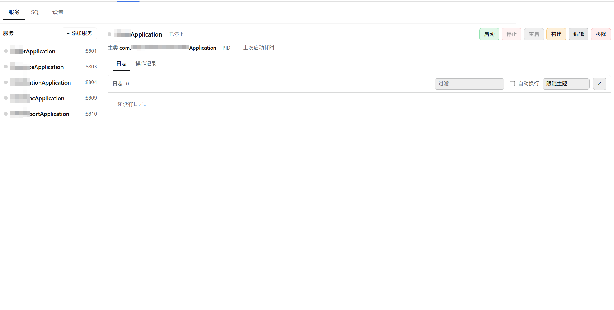
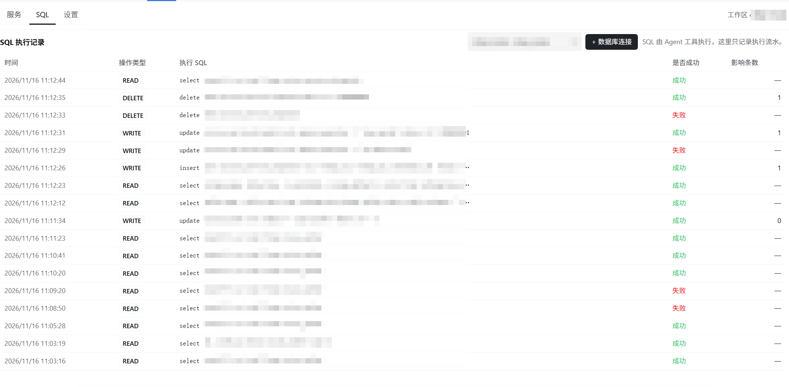
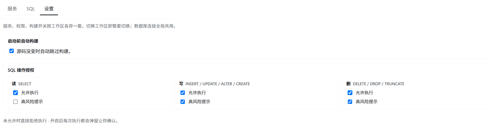

# dsh-java-ops

> 在 DeepSeek Harness 里跑 Java / Spring Boot 服务、查数据库：面板点启停、Agent 调工具，日志与 SQL 都在同一个会话里。

## 安装

```bash
dsh plugin --profile web add @gsnowdrift/dsh-java-ops
```

`dsh plugin` 会把参数原样转给 profile 目录里的 pnpm，所以这就是标准的加包流程。常用变体：

```bash
dsh plugin --profile web remove @gsnowdrift/dsh-java-ops   # 卸载
dsh plugin --profile web why @gsnowdrift/dsh-java-ops      # 看装的是哪个版本
```

想装最新源码而不等 npm 发版：

```bash
dsh plugin --profile web add github:gsnowdrift/dsh-java-ops
```

`--profile` 填你实际用的 profile 名（Web GUI 默认常用 `web`，也可能是 `desktop`）。装完重启 DSH，再启用：

```
plugin_manager set_plugin  target=include:dsh-java-ops  enabled=true
```

本机需要 JDK 与 Maven（或项目自带 `mvnw`）——构建和启动都靠它；插件自身依赖 `mysql2`（纯 JS，无原生编译），安装时自动装。

本地开发用 link 方式：

```jsonc
// ~/.dsh/profiles/<profile>/package.json
{
  "dependencies": {
    "@gsnowdrift/dsh-java-ops": "link:/path/to/dsh-java-ops"
  }
}
```

首次链接后在该目录执行一次 `npm install`，再按上面同样的方式启用。

> 改完 `lib/` 下的代码要热重载插件，并**刷新页面**——已加载的 client 模块不会自己重跑。

## 截图

**服务** —— 左侧服务列表，右侧详情、启动/停止/重启/构建按钮与实时日志：



**SQL** —— 执行记录（时间 / 操作类型 / 执行 SQL / 是否成功 / 影响条数）与连接切换：



**设置** —— 启动前自动构建开关，SQL 三组权限与高风险提示：



## 特性

| 能力 | 说明 |
| --- | --- |
| 服务发现 | 扫描 `@SpringBootApplication` / `@EnableAutoConfiguration` / 带 `main` 的类，按最近 `pom.xml` / `build.gradle` 归属模块，从 `application*.yml` 读端口、`context-path`、profile |
| 添加服务 | 下拉联想（输包名或类名即可筛）+ 手填全限定类名；端口、服务名、VM 参数、profile 均可改 |
| 启停重启 | 启动前自动构建（可关）、等待就绪（最长 120s）、快速失败；同一服务单实例守卫，不同服务可并行 |
| 停止 | actuator `/actuator/shutdown` → `taskkill` → 30s 未退出才强杀 |
| 构建 | `mvnw` / `gradlew` 优先，失败给 `file:line` 结构化错误 |
| 日志 | 实时日志分级着色、搜索过滤、放大、Esc 退出；每次启动/重启清空上一轮 |
| SQL | 三组权限（读/写/删）+ 可选高风险确认、结果 500 行 / 10s 超时、执行记录留 3 天 |
| 凭据 | 数据库密码只进 DSH credentials，不落 JSON、不回显 |

## 工具

Agent 侧通过工具操作，人看面板：

| 工具 | 作用 |
| --- | --- |
| `java_ops_project_scan` | 扫描启动类候选 |
| `java_ops_service_list` | 服务列表、状态、PID、SQL 权限与最近执行记录 |
| `java_ops_service_add` / `java_ops_service_remove` | 登记 / 移除服务 |
| `java_ops_service_start` / `java_ops_service_stop` / `java_ops_service_restart` | 启动 / 停止 / 重启 |
| `java_ops_service_ensure` | 幂等入口：没在跑就启动并等到就绪 |
| `java_ops_service_status` | 状态 + 日志，支持 `grep` / `level` / `tail` |
| `java_ops_build` | 只构建，返回结构化错误 |
| `java_ops_sql_connections` | 列出数据库连接 |
| `java_ops_sql_query` | 执行 SQL（受权限矩阵约束） |

工具都接受可选的 `workspace`（项目根绝对路径）；不传时按「会话 cwd → 最近用过的项目根」解析。

## 数据安全

- 状态文件：`~/.dsh/profiles/<profile>/plugin-data/java-ops.json`
  结构：`{ workspaces: { [root]: { services, buildEnabled, sqlPerms } }, seq, sqlConnections, sqlLog }`
- 服务、数据库连接、SQL 执行记录、权限与构建开关都按工作区各存一套。
- 数据库密码：DSH credentials，ref 形如 `JAVA_OPS_SQL_<ID>`，不落 JSON、不回显。
- SQL 权限模型：

| 组 | 覆盖语句 | 默认 |
| --- | --- | --- |
| 读 | `SELECT` / `SHOW` / `DESC` / `EXPLAIN` / `WITH` | 允许 |
| 写 | 其余语句：`INSERT` / `UPDATE` / `ALTER` / `CREATE` … | 拒绝 |
| 删 | `DELETE` / `DROP` / `TRUNCATE` | 拒绝 |

每组两个开关：**允许执行**（关闭即拒绝并留痕）、**高风险提示**（开启后每次执行弹 DSH 原生确认框）。无 `WHERE` 的 `UPDATE` / `DELETE` 一律拦截，判断前先剥掉字符串与注释里的 `where`，避免 `note='no-where'` 这类绕过。

## 限制

- 只隔离进程，不做端口预检：两个服务配同一端口时，后启动的会失败（`port not ready in time`）。
- Gradle 支持有限，构建主走 Maven wrapper / `mvn`。
- 表结构浏览、DDL 专门界面、PG / Oracle / 达梦等驱动尚在计划中。

实现细节与历史决策见 [docs/DETAIL.md](docs/DETAIL.md)、[docs/decision-map.md](docs/decision-map.md)。
